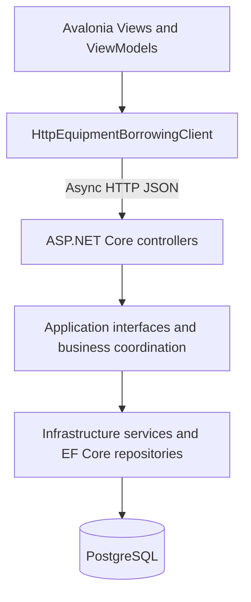

# Implementation baseline and architecture

- Authentic Lab 4 submission: `4a8f8936ad8769e0ae63297fc497f52962adf513` (user verified local/main and origin/main; `lab4-submitted` points to the original revision). Check with `git rev-parse lab4-submitted`.
- Lab 5 final revision: resolve `git rev-parse lab5-submitted` after final verification and tagging; do not invent the hash or tag a preliminary revision. Final tag must resolve to the submitted revision. Development branch: `feature/lab5-api-integration`.
- Baseline limitation: Lab 4 documentation records prior incomplete evidence for some cases. Do not represent those historical gaps as completed retroactively.

## Boundary before and after

Before: Avalonia ViewModels -> Application interfaces -> PostgreSQL repositories/services -> EF Core -> PostgreSQL.

After:

Desktop composition: `src/EquipmentBorrowing.Desktop/App.axaml.cs`, HTTP adapter in `Services/HttpEquipmentBorrowingClient.cs`. Only Application is a direct desktop project reference. API composition: `src/EquipmentBorrowing.Api/Program.cs`, `Extensions/ServiceCollectionExtensions.cs`. Business writes and transaction boundaries are in `src/EquipmentBorrowing.Infrastructure/Services/PostgreSqlAtomicBorrowingService.cs`, `PostgreSqlStudentManagementService.cs` and `PostgreSqlEquipmentManagementService.cs`. Persistence context and original four migrations remain in Infrastructure. IDs, normalized uniqueness, relationships and returned history are preserved. API owns Manila dates. Desktop rehydrates read snapshots; the server revalidates mutations. Optional legacy StudentYear is preserved on server edits but is no longer editable in desktop because the published student API has no field for it; original use-case preservation should be checked against authoritative Lab 4 suite.

Known 500 and no HTTP response are distinct; unknown outcomes are not automatically retried. Per-workflow refresh guards reside in StudentManagementViewModel, EquipmentViewModel, BorrowViewModel and ActiveBorrowingsViewModel. This design does not establish that a real lost commit acknowledgement was experimentally induced.
